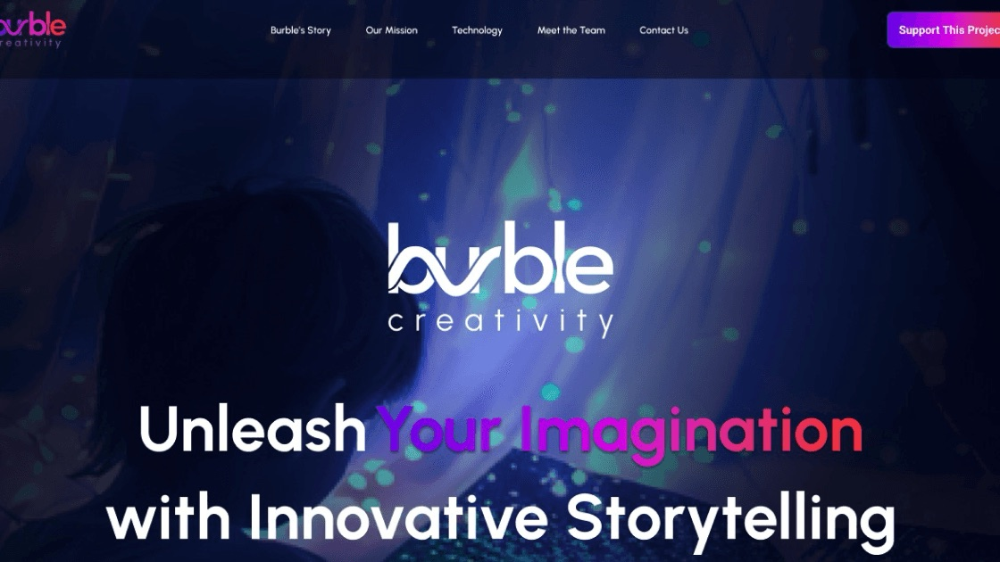
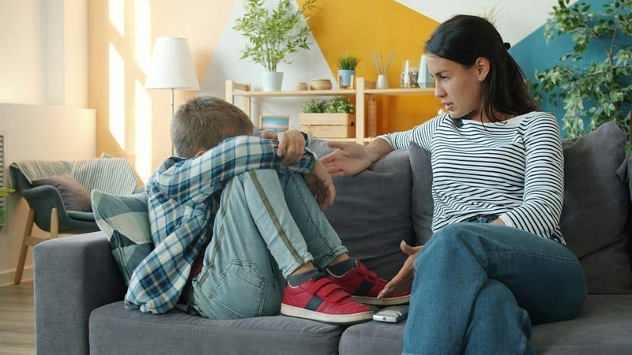
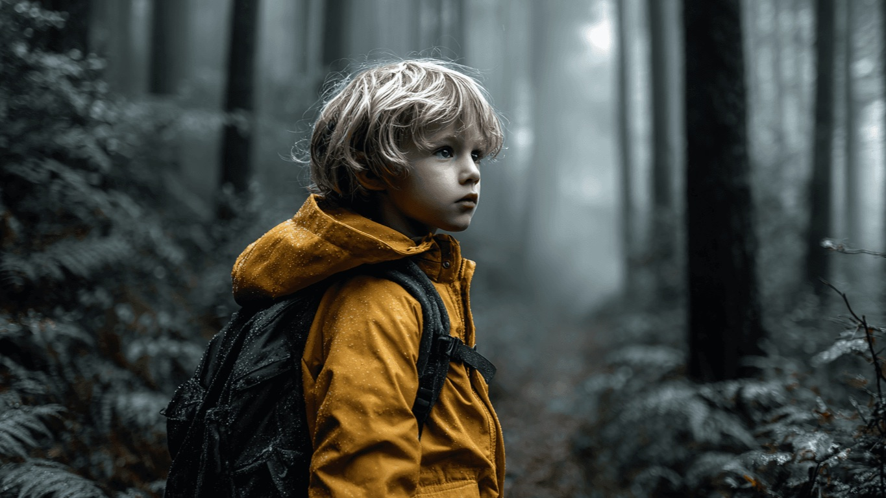

---
# ─────────────────────────────────────────────────────────────────────────────
# Burble: everything on the site for this case study lives in this file. Save
# it and the site updates. Anything in [square brackets] shows up red while
# review mode is on, so use brackets for notes that still need attention.
#
# Starter content taken from burbleneuro.com (Oct 2026). Everything about what
# Miles did is still to be filled in from his answers.
#
# Tip: wrap a value in double quotes if it starts with [ or # or contains a colon.
# ─────────────────────────────────────────────────────────────────────────────

id: calm-by-design           # used in the page address: /watch/calm-by-design
title: Calm by Design
subtitle: The Burble Story
tagline: Turning the screens families already own into the calm their kids need.
description: >-
  Burble is a sensory regulation app for autistic learners. It turns everyday
  phones, tablets, and TVs into calm, sensory-safe environments, at home, at
  school, and in therapy. [What Miles did, in one sentence.]

category: product            # product, brand, leadership, or documentary
client: BurbleNeuro
role: Chief Product Officer
year: 2026                   # [confirm: when Miles started at Burble]
format: Series               # Series, Feature, Limited Series, or Short
genre: Neurotech
rating: UX-G
advisories: [sensory design, calm screens, regulation]
badge: New Chapter           # optional: New Chapter, Recently Added, Award Winner, Top 10, Coming Soon
match: 98

team:
  - "Miles Hillier (Chief Product Officer: product strategy and UX systems)"
  - "Amelia Soriano (Co-Founder & CEO)"
  - "Taylor Cole (Co-Founder, originator of MDI™)"
  - "Jay Goth (Chief Financial Officer)"
disciplines: [Product Strategy, UX Systems, "[more?]"]
tools: ["[tools?]"]
moods: [Calm, Mission-Driven]

# From burbleneuro.com. These are company figures, not results of Miles's work,
# and Burble is still pre-launch (waitlist), so confirm before keeping them.
outcomes:
  - value: "1,000+"
    label: "Families on the waitlist [confirm]"
  - value: "100+"
    label: "Prototype testers [confirm]"
  - value: "95%"
    label: "Positive tester feedback [confirm]"

# Images: file names are relative to this folder. A missing file falls back to
# placeholder art (outlined red in review mode). All taken from burbleneuro.com.
cover: cover.jpg             # two kids in an immersive blue projection room
video: cover.mp4             # looping particle footage from the Burble media library, plays behind headers
logo: logo.svg               # the burble wordmark (white)

accent: "#22C5B1"            # Burble teal: artwork glow, subtitle, season labels
highlight: "#5D0DFF"         # Burble violet: result numbers, pull quotes, progress bar
titleFont:
  font: "'Figtree', sans-serif"
  weight: 800
  letterSpacing: -0.02em
---

# The Burble Story

## Too Much, Too Loud · 2 min

_Screens built to grab attention, and kids who need the opposite._

Most children's media is built to stimulate: fast cuts, bright colour, constant sound. For many autistic kids that is the opposite of what they need. Burble's own figures put the scale plainly: 1 in 31 children in the U.S. is autistic, and autistic students are chronically absent at nearly twice the rate of their neurotypical peers.

[Miles: how you came to Burble, and what the problem looked like when you arrived.]

## From Storytelling to Regulation · 2 min

_Burble Creativity becomes Burble._

[The site's earlier brand was "Burble Creativity: Unleash your imagination with innovative storytelling." Was the move to a sensory regulation product, and the new Burble identity, your work? What changed and why?]

## Minimally Defined Immersion · 3 min

_A methodology built from lived experience._

Burble is built on MDI™ (Minimally Defined Immersion), a methodology created by co-founder Taylor Cole from lived experience with auditory processing disorder. It is a human-built set of more than a hundred pages of interdependent sensory design rules: slow visual pacing, low sensory contrast, and ambient sound. Every experience is reviewed by a person before it's published.

[Miles: how did you turn the MDI rules into product and UX decisions?]

## Press Play · 2 min

_No hardware, no setup, no new routine._

The product works on the phones, tablets, and TVs families and classrooms already have. Download the app, pick an experience for overwhelm, shutdown, or a transition, and press play. Experiences can be downloaded for places without Wi-Fi, like the school bus, and the same experience carries across home, school, and therapy.

[Miles: your part in this flow, what you tested with the 100+ prototype testers, and what you learned.]

## Where It Stands · 1 min

_Families, schools, and clinics._

[Be precise about status: what is launched, what is in testing, and what the LAUSD · Spectrum 360 deployment is.]
