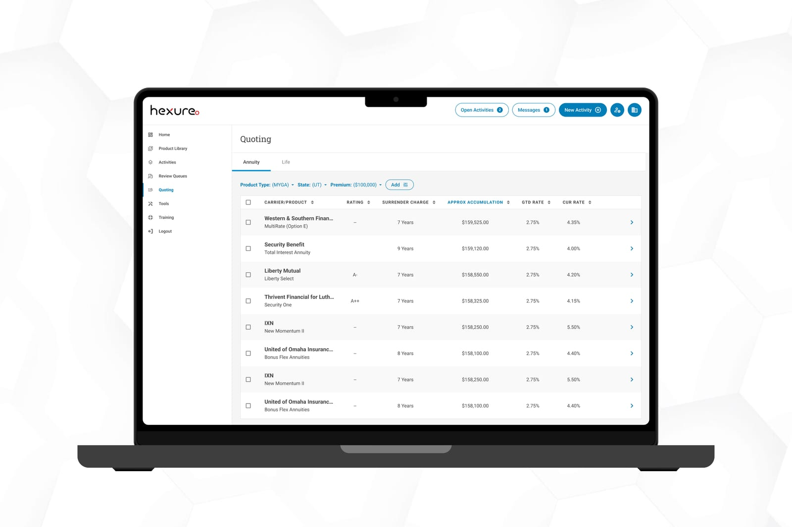
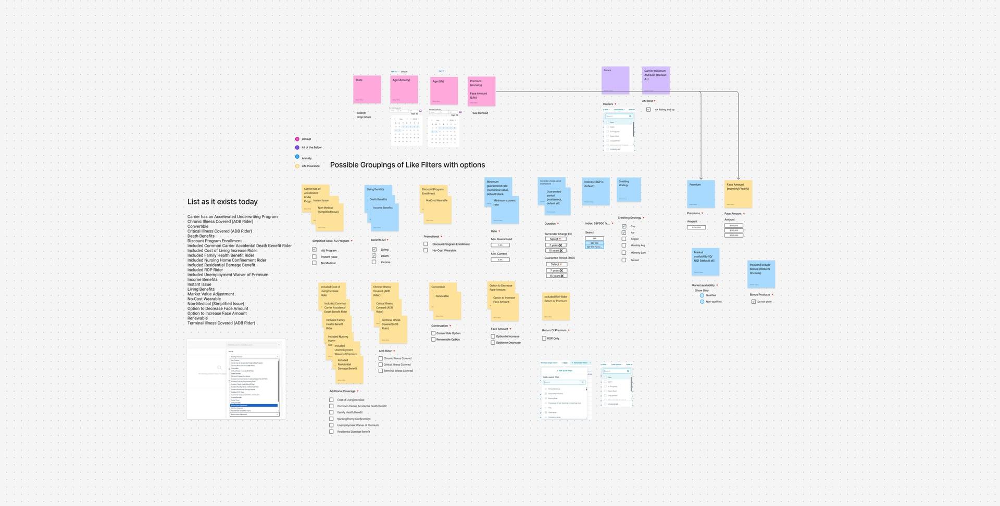
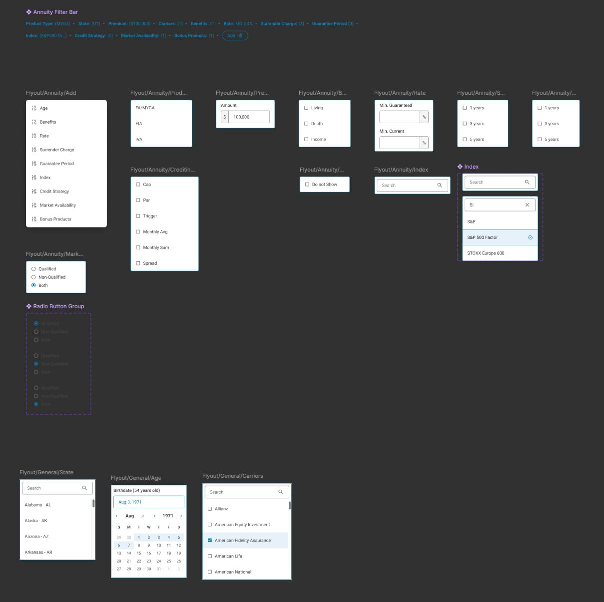
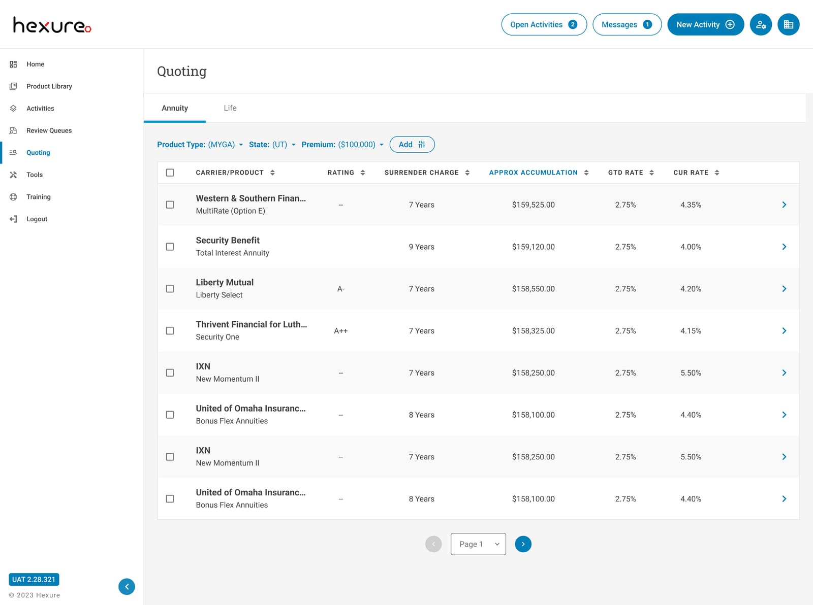
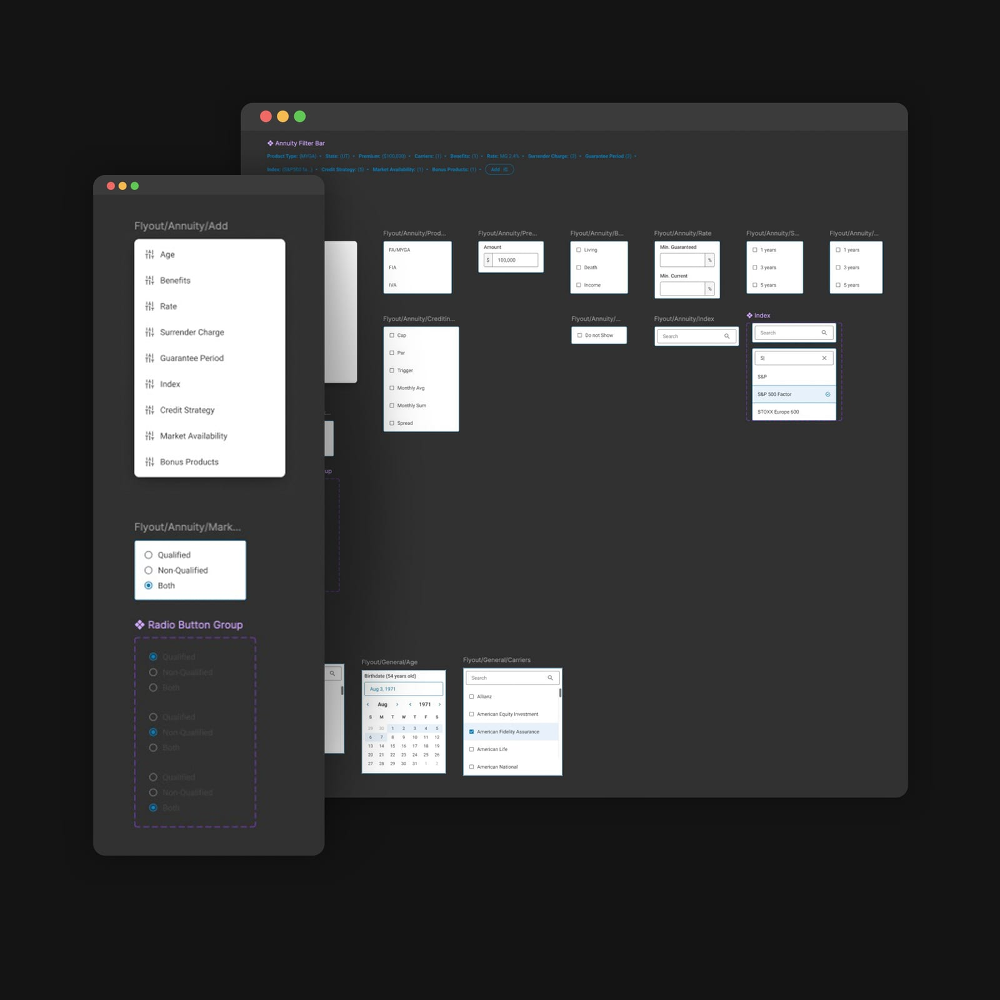
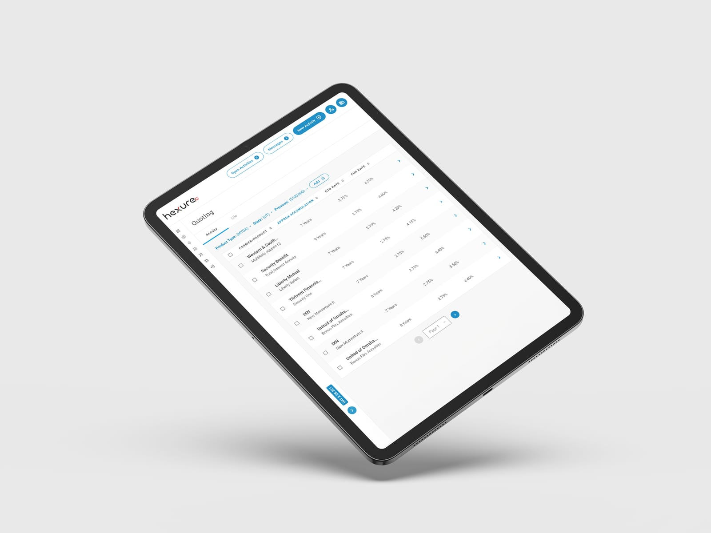
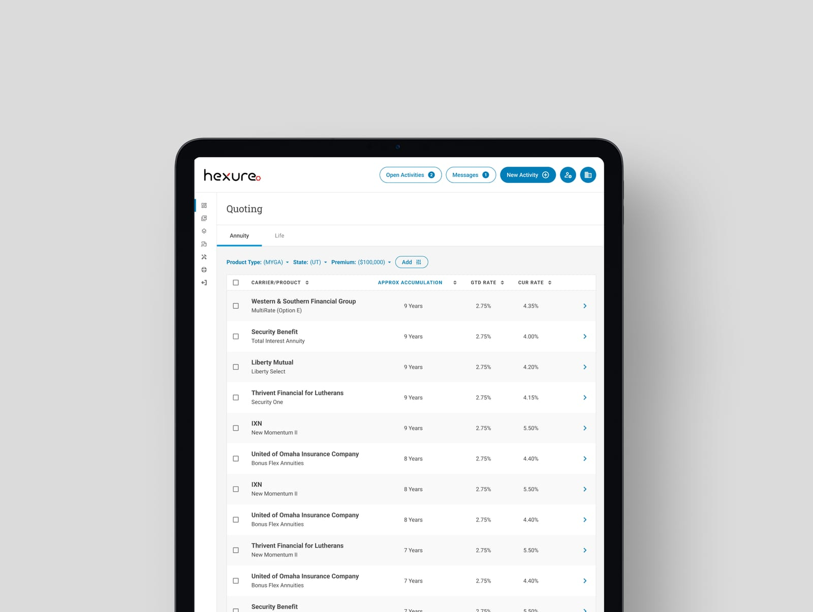

---
# ─────────────────────────────────────────────────────────────────────────────
# Four Into One: everything on the site for this case study lives in this file.
# Save it and the site updates. Anything in [square brackets] shows up red
# while review mode is on, so use brackets for notes that still need attention.
#
# Tip: wrap a value in double quotes if it starts with [ or # or contains a colon.
# ─────────────────────────────────────────────────────────────────────────────

id: four-into-one            # used in the page address: /watch/four-into-one
title: Four Into One
subtitle: The Hexure Quoting Platform Story
tagline: Four quoting tools, six product teams, and one system to hold them together.
description: >-
  Hexure’s customers were quoting across four separate tools, each with its own
  patterns and quirks. This is the story of designing one platform to replace them,
  built on a rebuilt design system that six product teams adopted, and the prototype
  that got leadership behind a projected $3.45M–$5.45M in first-year revenue.

category: product            # product, brand, leadership, or documentary
client: Hexure
role: Principal Product Designer
year: 2025
format: Limited Series       # Series, Feature, Limited Series, or Short
genre: Insurtech
rating: UX-PG
advisories: [consolidation, design systems, alignment]
badge: New Chapter           # optional: New Chapter, Recently Added, Award Winner, Top 10, Coming Soon
match: 97

team:
  - Miles Hillier (sole designer)
  - 3 Product Managers
  - 3 Engineers
  - VP of Product
disciplines: [Product Design, Design Systems, UX Strategy]
tools: [Figma, Storybook, Jira]
moods: [Ambitious, Collaborative]

outcomes:
  - value: "4 → 1"
    label: Quoting tools unified in one design
  - value: "$3.45–5.45M"
    label: Projected first-year revenue
  - value: "~3 min"
    label: Average quote in testing, down from 5–10

# Images: file names are relative to this folder. A missing file falls back to
# placeholder art (outlined red in review mode).
cover: cover.jpg             # cards and thumbnails
banner: banner.jpg           # page headers (dark, so the title stays readable)
logo: logo.png

accent: "#E82425"            # Hexure red: artwork glow, subtitle, season labels
highlight: "#E82425"         # result numbers, pull quotes, progress bar
titleFont:
  font: "'Bebas Neue', sans-serif"
  letterSpacing: 0.04em
  uppercase: true
---

<!--
  How the chapters below are written:

  # Season name                     → starts a season
  ## Chapter title · 2 min          → starts a chapter (read time is optional)
  _One-line summary_                → the chapter's synopsis (italic line under the title)
                 → the chapter image and its caption
  Plain paragraphs                  → body text
  - item  or  1. item               → bulleted or numbered list
  > Quote text                      → pull quote; a final "> — Name, Title" line is the credit
-->

# Discovery

## The Brief · 2 min

_Two acquisitions, one half-finished merge, and four quoting tools where there should have been one._

I joined Hexure in February 2024 as Principal Product, UX/UI Design System Designer. Acquisitions had left the company with four separate quoting tools:

1. Hexure’s original annuity quoting tool.
2. An annuity quoting tool from IXN, an acquired company.
3. A half-finished attempt by a previous designer to merge the first two, which was only partly in use for annuities.
4. A life insurance quoting tool from Vive, acquired after that merge attempt had stalled.

The tools were used by distributors and sales agents to quote annuity and life insurance products for their clients. Their biggest complaint was constantly switching between tools. Each one did some things better than the others, so no single tool covered a full day’s work. Some were slow to search and to return accurate numbers, and some were simply hard to look at.

Stakeholders had originally asked the previous designer to merge the two annuity tools, Hexure’s and IXN’s. Then Vive came along. Its life insurance tool had a strong track record and could fit naturally into one global tool supporting both annuities and life insurance. Leadership’s request became a simplified quoting tool that would unify the fragmented systems and position Hexure to expand into the life insurance market. Along the way, several leadership reorgs meant the original stakeholders were lost in the shuffle, so the brief had no clear owner. It took shape as I dug in and learned more.

Instead of picking up where the old merge left off, or throwing it out, I took time to understand what the previous designer had been trying to do. I gathered feedback from internal and external users, evaluated the use cases and how much flexibility the platform would need in the future, and started putting the pieces together.

The deeper I looked, the more problems surfaced that nobody had asked me to solve:

- Agents re-entered the same client data again and again across systems.
- Quote reports lacked consistency and looked unprofessional.
- Product teams were maintaining duplicate systems with conflicting logic.
- There was no shared design language and no way to reuse data across platforms.
- The fragmented tools were hurting Hexure’s credibility and slowing growth.

## Into the Field · 2 min

_A full audit of four tools, support call notes, and interviews across product, sales, support, and the field._

I started with what already existed. I ran a complete audit of all four quoting tools, documenting every flow and UX gap in Figma. I reviewed the designs the previous designer had been working on, and read through notes from customer support calls to see where users were struggling most.

Then I interviewed eight or nine people to find out what was working and what wasn’t. Most were internal stakeholders from Product, Sales, and Support, and a few came from the distributor and carrier side.

## The Synthesis Wall · 2 min

_The overlap between the tools becomes the case for one platform and one system._

Two findings shaped everything that followed. First, regulations, products, and the way product packages were distributed weren’t consistent across insurance software. A single tool would have to handle that variety instead of assuming one standard.

Second, and most surprising, a more complex interface was performing better than a simpler one. Agents could see more information up front instead of hunting for it behind dropdowns or messy navigation. Tabs and filters, pre-set with the information that best fit the agent’s location, meant less clicking around and more selling.

I distilled everything into three shared goals: efficiency, accuracy, and consistency. Together they gave the project a clear target: one quoting tool for annuities and life insurance that shows agents what they need up front, so they spend less time clicking and more time selling.

# Design & Delivery

## Rough Cuts · 2 min

_One quoting flow designed to serve four sets of users._

I sketched and mapped early navigation and workflow concepts directly in Figma, and worked closely with the PM to define the core features and a single navigation model for every product. The flow was built around what the research showed: show more up front. Putting the information agents needed on screen, instead of behind menus, also let them adjust their quotes faster.

I turned the concepts into a high-fidelity, clickable prototype covering three core flows:

1. Navigation: switching seamlessly between annuities and life insurance.
2. Filtering and input: start simple, then refine step by step.
3. Quote results: a summary first, with deeper detail available on demand.

Presenting the prototype to cross-functional stakeholders got everyone aligned on a shared vision before any engineering began.

The hardest calls weren’t about layout. I had to give up some visual polish in favor of density and speed, which isn’t easy for a designer to do. And I had to shape a rollout plan that worked for every department leader, each with different priorities, so I spent as much time on stakeholder strategy as on screens.

Testing with agents led to one of the biggest wins. I noticed them selecting the same things every time, like their state and annual contribution amounts. When I asked how often they changed those values, they said rarely. So the design started selecting them automatically on load, which made it quicker to search and get to a quote.

## The System · 2 min

_A shared design system becomes the foundation six product teams build on._

Hexure’s products had drifted into many different versions of themselves, and plenty of them looked like they were built for Windows 95. The previous designer had started a design system, but it only existed as a work in progress in Figma. I audited it, then rebuilt it, working with a development team in India to build it out in code. The result covered colors and type styles, a Figma component library, coded components, documentation, and a process for teams to request and contribute changes.

That meant designing flexible components that could scale between annuity and life insurance quoting. The universal quoter was the system’s first real test. As I designed it, I made sure every element on screen was part of the design system from the start, with no one-off pieces. That proved the system could carry a complex, high-stakes product, and six product teams went on to adopt it.

I didn’t have to force it on them. I got teams excited by inviting them to contribute, so the system was partly theirs, and by showing them the value it would bring to their own products.

I led end-to-end product design across multiple teams and departments, for both internal and customer-facing work.

## The Green Light · 2 min

_A prototype, a phased plan, and a business case that put the platform at the center of Hexure’s strategy._

The rollout plan had to work for every department leader, so I shaped it in stages: a small group of agents first, then annuities, bringing Hexure’s and IXN’s users together, then life insurance from Vive.

The unified quoting platform became the foundation of Hexure’s quoting modernization strategy, aligning leadership, product, and engineering around a shared vision before engineering began. Where it landed:

- Quoting tools: four unified into one design, with one application and one sign-in
- Time to quote: down from 5–10 minutes to about three minutes on average in testing
- Projected revenue increase: $3.45M–$5.45M in year one, and $7.25M–$11.25M by year three
- Design system: rebuilt and adopted by six product teams
- Design established as a strategic driver of growth

## Epilogue: What We Learned · 1 min

_Simple isn’t always better, especially for people who use a tool all day._

The biggest lesson was that simple isn’t always better. I went in assuming the cleaner interface would win. Watching agents work showed me that, for people who quote all day, seeing everything up front beats a tidy screen. Good design for experts starts with how they actually work, not with how the screen looks.

A few other lessons stuck with me. Rapid prototyping can unite leadership early and speed up decisions. Visual documentation builds alignment with people who aren’t designers. And designing a universal tool takes both modular thinking and empathy for every system it replaces.

If I did it again, I’d set up proper measurement from day one, so results like the faster time to quote were backed by harder data from the start. And it showed me that strategic design can change a company’s direction even before engineering begins.
