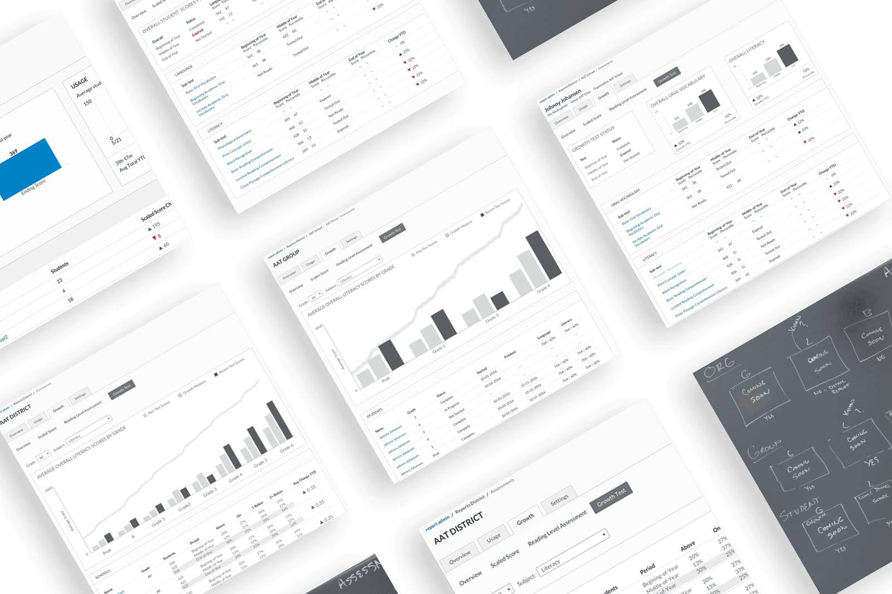
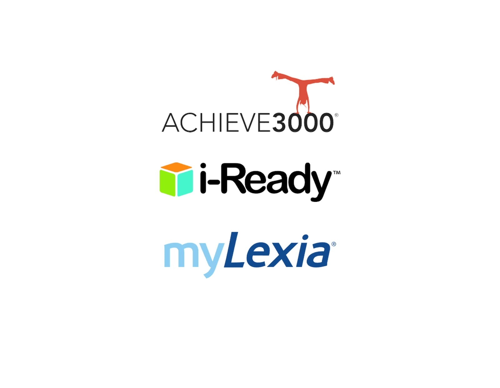
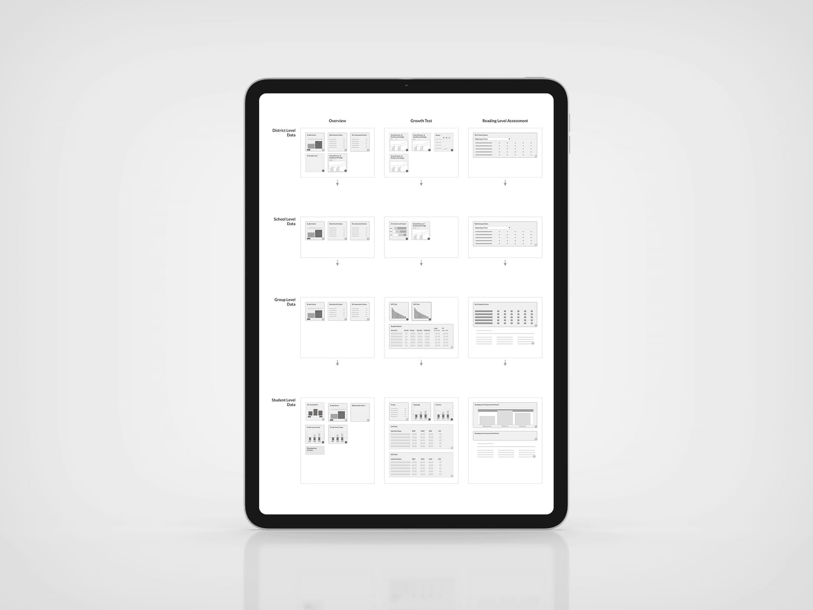
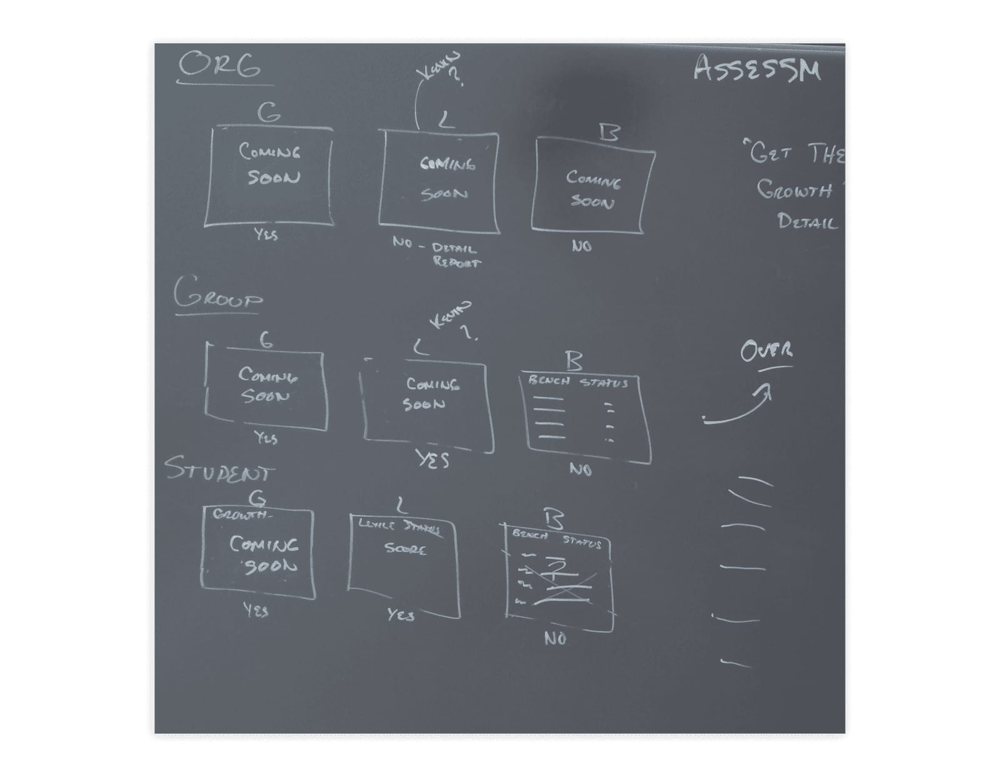
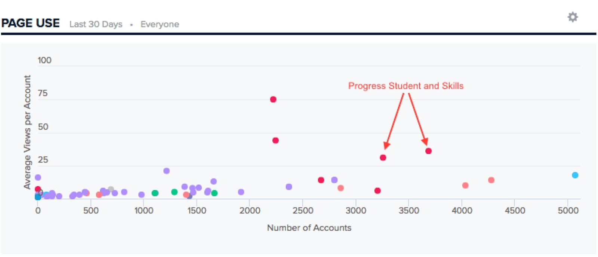
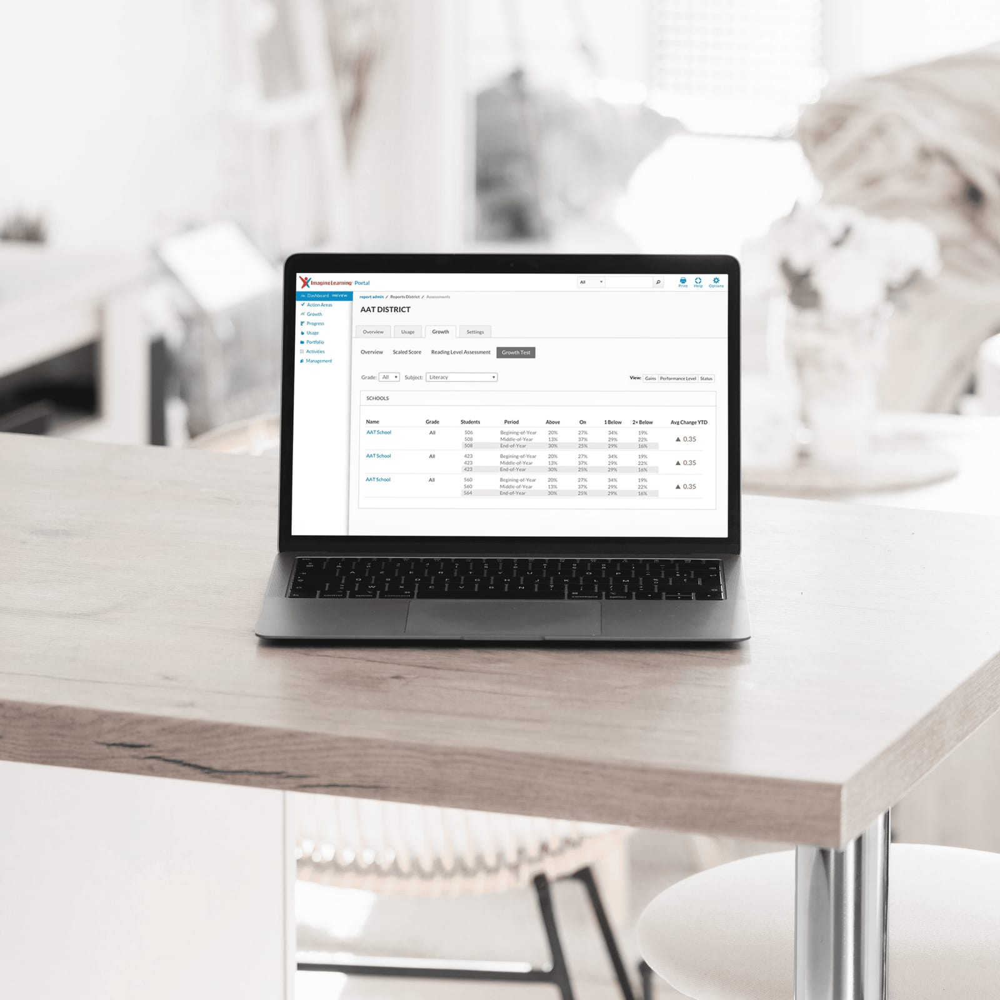
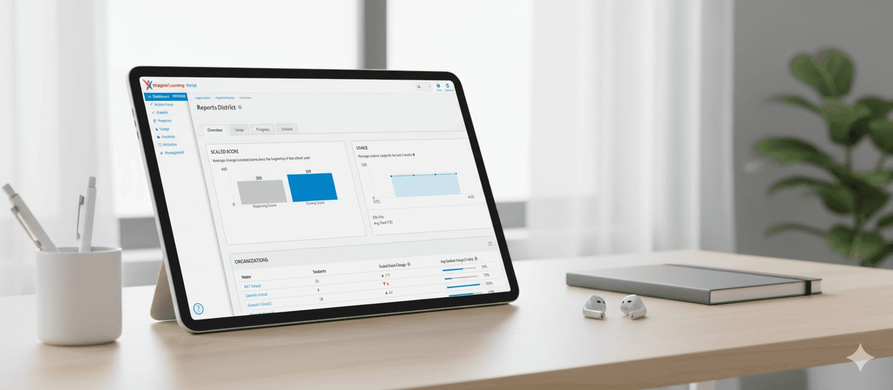

---
# ─────────────────────────────────────────────────────────────────────────────
# Report Card: everything on the site for this case study lives in this file.
# Save it and the site updates. Anything in [square brackets] shows up red
# while review mode is on, so use brackets for notes that still need attention.
#
# Tip: wrap a value in double quotes if it starts with [ or # or contains a colon.
# ─────────────────────────────────────────────────────────────────────────────

id: report-card              # used in the page address: /watch/report-card
title: Report Card
subtitle: The Imagine Learning Reporting Story
tagline: From zero reporting to a working analytics dashboard in three months.
description: >-
  Teachers and administrators couldn’t see how their students were doing without
  hours of manual spreadsheets, and the funding behind their programs depended on
  proving it. This is the story of building Imagine Learning’s first reporting
  dashboard, from student to district, in just three months.

category: product            # product, brand, leadership, or documentary
client: Imagine Learning
role: Senior UX/UI Designer
year: 2016                   # [confirm the year the MVP shipped]
format: Limited Series       # Series, Feature, Limited Series, or Short
genre: EdTech
rating: UX-PG
advisories: [data, funding, field research]
badge: New Chapter           # optional: New Chapter, Recently Added, Award Winner, Top 10, Coming Soon
match: 95

team:
  - Miles Hillier
  - "[team: how many PMs, developers, and QA?]"
disciplines: [Product Design, Data Visualization, User Research]
tools: [Pendo, "[design tools you used, e.g. Sketch]"]
moods: [Data-Driven, Collaborative]

outcomes:
  - value: "3 mo"
    label: From zero reporting to MVP
  - value: "4"
    label: Report levels, student to district
  - value: Hours
    label: Of manual reporting saved per teacher, each week

# Images: file names are relative to this folder. A missing file falls back to
# placeholder art (outlined red in review mode).
cover: cover.jpg
logo: logo.png

accent: "#D43538"            # Imagine Learning red: artwork glow, subtitle, season labels
titleFont:
  font: "'Bebas Neue', sans-serif"
  letterSpacing: 0.04em
  uppercase: true
---

<!--
  How the chapters below are written:

  # Season name                     → starts a season
  ## Chapter title · 2 min          → starts a chapter (read time is optional)
  _One-line summary_                → the chapter's synopsis (italic line under the title)
                 → the chapter image and its caption
  Plain paragraphs                  → body text
  - item  or  1. item               → bulleted or numbered list
  > Quote text                      → pull quote; a final "> — Name, Title" line is the credit
-->

# Discovery

## The Brief · 2 min

_Hours of spreadsheets, funding on the line, and no way to see how students were really doing._

I joined Imagine Learning in 2015 as a Senior UX/UI Designer. Teachers and administrators were using its programs every day, but they had almost no visibility into student progress. To justify their programs and the government funding behind them, educators spent countless hours compiling reports by hand.

The request was to create a reporting solution that automatically turned student activity data into meaningful insights for teachers, school admins, and district leaders, while meeting the federal and state reporting requirements tied to that funding.

Once I dug in, the problems ran deeper than the brief:

- No one had a clear picture of what “effective reporting” looked like for each role.
- Educators spent hours building spreadsheets for parent and admin meetings.
- Inconsistent or incomplete data made school-level reports unreliable.
- Teachers, schools, and districts each needed their own tailored view.
- Early data logic issues risked inaccurate numbers when metrics rolled up from one level to the next.

## Into the Field · 2 min

_Competitor teardowns, field reps, and the teachers and admins who live with the reports._

I started by studying the competition. Tools like i-Ready, myLexia, and Achieve3000 set the bar for what educators expected, and showed where there were gaps to fill.

Next I went to the people closest to the classroom. Imagine Learning’s field representatives worked directly with teachers and districts, so I interviewed them to understand day-to-day frustrations and data needs. Then I interviewed teachers and admins to check what I’d heard, and to learn how reports actually shaped decisions in the classroom and the district office.

[What was the biggest surprise from those interviews? For example, something teachers needed that no competitor offered.]

## The Status Map · 2 min

_Every report, every level, and every stage of development on one living map._

With four levels of reporting (District, School, Group/Class, and Student) and several audiences, it was easy to lose track. I created a dynamic “status map” that showed every report type and its stage of development, so the whole team could see the full picture at a glance.

[What did the map help you decide? For example, which reports to build first for the MVP.]

# Design & Delivery

## Rough Cuts · 2 min

_Sketches and whiteboards become report modules that scale from one student to a whole district._

I sketched and whiteboarded dashboard layouts to find patterns, overlaps, and chances for consistency across the four levels. The answer was a set of flexible report modules: the same building blocks could show a single student’s progress or a district-wide summary.

From there I built early prototypes showing the flow and hierarchy of the reports, from the district view down to the individual student.

## Field Testing · 2 min

_Early access links, live walkthroughs, and usage data shape every sprint._

I shared early access links with field reps and walked through the reports with them to get real-time usability feedback. I also set up Pendo analytics to track how people actually used the dashboard and where they got stuck.

Each sprint, we adjusted features and flows based on what the field reps told us and what the usage data showed. I led the PMs, developers, and QA through the rollout across every audience. [One concrete example of something you changed because of the feedback or data.]

## Report Day · 2 min

_From nothing to a working analytics dashboard in three months._

We delivered the MVP in just three months, taking Imagine Learning from no reporting infrastructure at all to a fully working analytics dashboard. The results:

- Manual reporting time: cut by several hours per teacher, every week
- Compliance: automated insights supporting district and state requirements
- Funding: continuous program accountability, helping secure ongoing government funding
- Visibility: clear views for every level, from teacher to school to district

The dashboard became a foundational tool for Imagine Learning, giving educators real-time data, improving classroom decisions, and helping secure continued funding for student programs.

## Epilogue: What We Learned · 1 min

_Small logic gaps grow into big reporting problems._

Three lessons stuck with me. Collaboration between field reps, educators, and designers creates more empathetic and accurate reporting tools. Continuous feedback loops, through Pendo data and live walkthroughs, make iteration faster and keep it focused on users. And early alignment on data structures is critical, because small logic gaps can scale into major reporting issues.

[One honest thing you’d do differently.]
