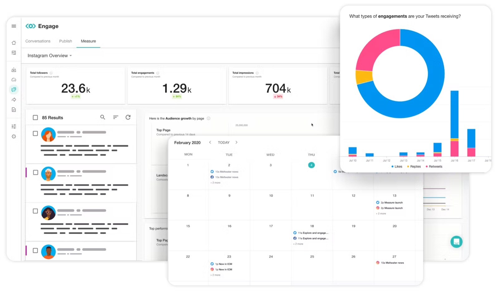
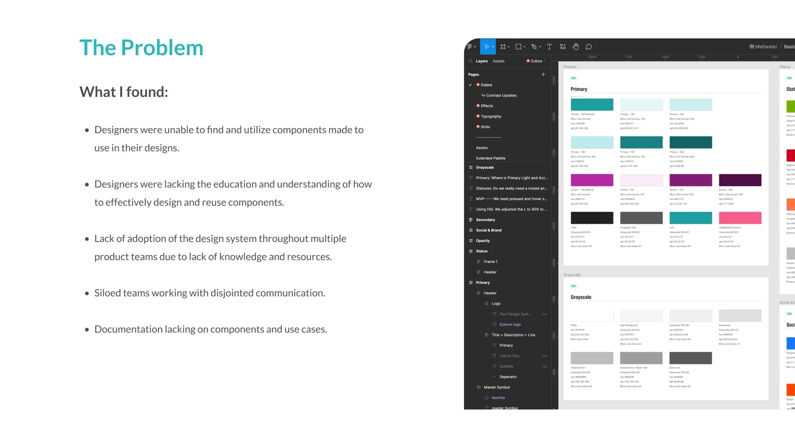
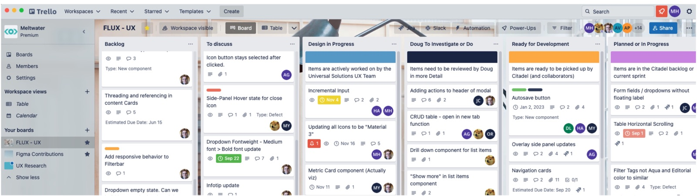
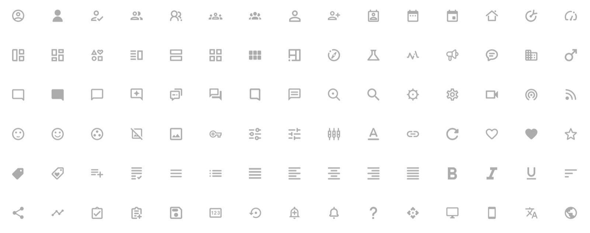
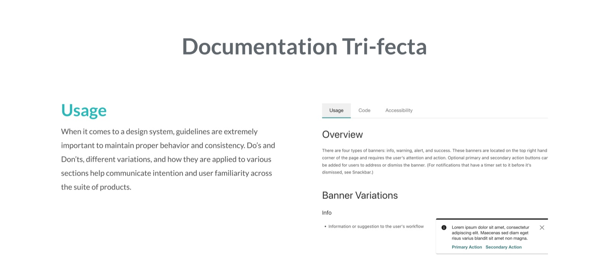
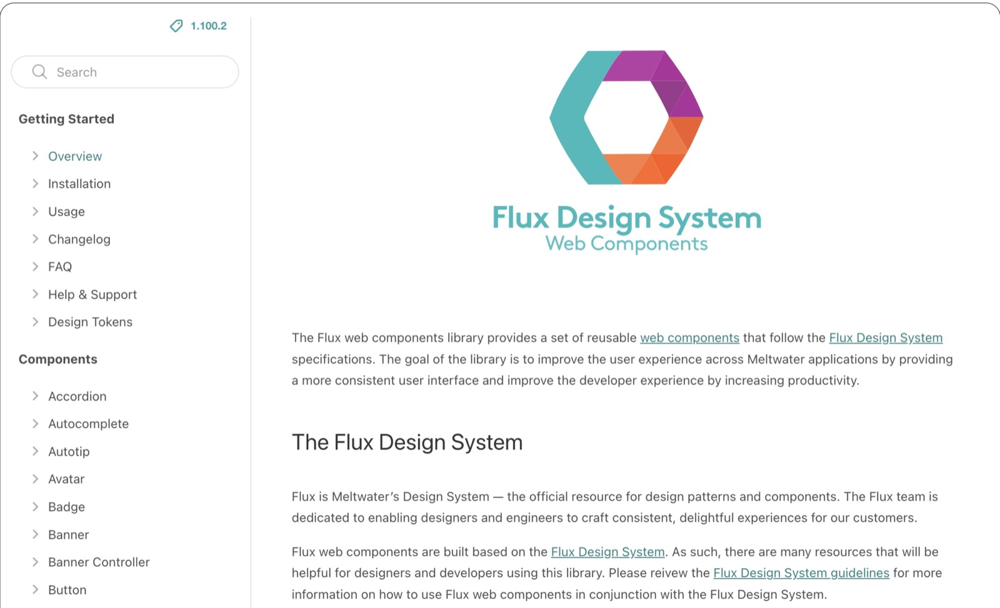
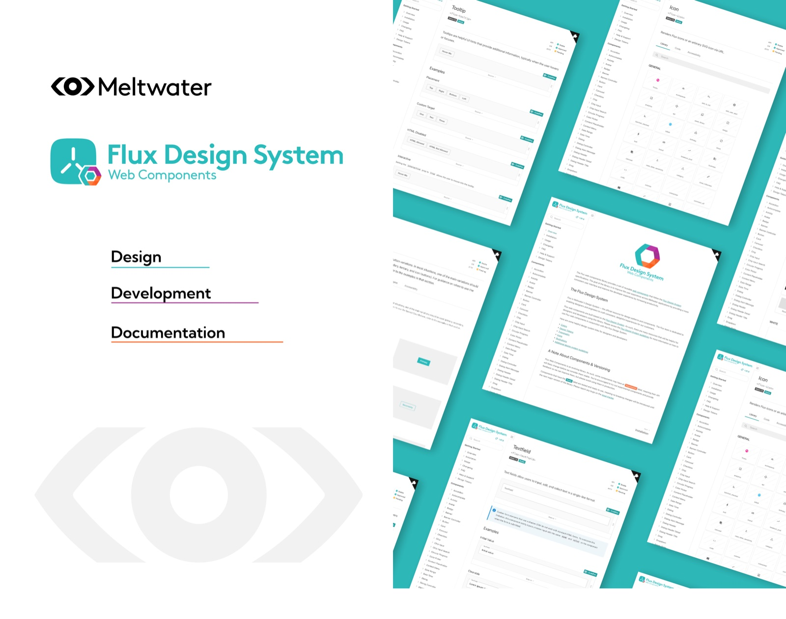

---
# ─────────────────────────────────────────────────────────────────────────────
# Common Ground: everything on the site for this case study lives in this file.
# Save it and the site updates. Anything in [square brackets] shows up red
# while review mode is on, so use brackets for notes that still need attention.
#
# Tip: wrap a value in double quotes if it starts with [ or # or contains a colon.
# ─────────────────────────────────────────────────────────────────────────────

id: common-ground            # used in the page address: /watch/common-ground
title: Common Ground
subtitle: The Meltwater Design System Story
tagline: One system, many products, and the trust it took to bring them together.
description: >-
  Meltwater’s product suite grew through acquisitions and internal builds, and
  its design system didn’t keep up. This is the story of rebuilding that system
  around the people who use it, and turning skeptics into contributors.

category: product            # product, brand, leadership, or documentary
client: Meltwater
role: Lead Product Designer
year: 2022
format: Limited Series       # Series, Feature, Limited Series, or Short
genre: B2B SaaS
rating: UX-PG
advisories: [adoption, governance, trust]
badge:                       # optional: New Chapter, Recently Added, Award Winner, Top 10, Coming Soon
match: 96

team:
  - Miles Hillier
  - Four engineering partners
disciplines: [Design Systems, Documentation, Design Enablement]
tools: [Figma, Trello, GitHub, CodePen]
moods: [Collaborative, Optimistic]

outcomes:
  - value: "7+"
    label: Product teams adopted in year one
  - value: "~80%"
    label: Less time to find components
  - value: 15-20 hrs
    label: Design hours saved per week

# Images: file names are relative to this folder. A missing file falls back to
# placeholder art (outlined red in review mode).
cover: cover.jpg
logo: logo.png

accent: "#1D9F9F"            # teal: artwork glow, subtitle, season labels
highlight: "#B627A1"         # magenta: result numbers, pull quotes, progress bar
titleFont:
  font: "'Space Grotesk', sans-serif"
  weight: 700
  letterSpacing: -0.03em
---

<!--
  How the chapters below are written:

  # Season name                     → starts a season
  ## Chapter title · 2 min          → starts a chapter (read time is optional)
  _One-line summary_                → the chapter's synopsis (italic line under the title)
                 → the chapter image and its caption
  Plain paragraphs                  → body text
  - item  or  1. item               → bulleted or numbered list
  > Quote text                      → pull quote; a final "> — Name, Title" line is the credit
-->

# The Common Ground Story

## The Brief · 2 min

_A suite built through acquisitions, a pile of scattered libraries, and a design system nobody trusted._

By 2022, Meltwater’s products were a patchwork of in-house builds and acquired tools. Each one came with its own libraries, naming, and habits. Designers couldn’t find or reuse components, documentation was scattered, and there was no training or governance. Customers moving between products felt the seams, and every inconsistency meant duplicate work for design and engineering.

I stepped in as Lead Product Designer to own the Flux Design System, Meltwater’s design system. On paper the brief was a cleanup: consolidate the libraries. It quickly became clear the real problem was trust. Designers had stopped relying on the system, PMs saw it as overhead, and developers had no clear way to request changes. So I defined success by adoption, not by component count.

## Into the Field · 2 min

_A library audit, designer interviews, and candid talks with PMs and developers reframe the problem._

I started with a full audit of the three Figma libraries in use, logging duplicates, naming conflicts, and components that had drifted from code. In parallel, I interviewed six designers across product teams about how they actually searched for and used components day to day.

Conversations with PMs and developers filled in the rest. PMs didn’t see system work on their roadmaps, so it always lost to features. Developers fielded ad hoc requests with no way to prioritize them. The pattern was clear: the libraries were fragmented, but the bigger gap was education and communication between siloed teams.

## The Synthesis Wall · 2 min

_Audit findings and interview notes collapse into four insights, three audiences, and one shared goal._

Synthesis surfaced four insights that explained why adoption had stalled:

1. Designers couldn’t find what already existed. Inconsistent naming and tagging made search unreliable, so people rebuilt instead.
2. Documentation was split and single-audience. Guidance lived in several places and rarely served designers and engineers at once.
3. System work had no home on roadmaps. Without PM buy-in, it was always the first thing cut.
4. Developers had no intake process. Requests arrived ad hoc, with no way to balance shared resources.

Instead of one big fix, I split the work by audience: designers, product managers, and developers. Each group needed different tools, education, and reasons to buy in. The goal that tied them together: help any team find, use, and trust the right component without having to ask around.

## Rough Cuts · 2 min

_The libraries are torn down and rebuilt around Atomic Design, then tested with the designers who use them._

I restructured the libraries with Brad Frost’s Atomic Design approach, organizing everything into atoms, molecules, and organisms. Naming and tagging were rebuilt so a search returned the right component the first time. Figma’s new component properties let me collapse near-duplicate variants into flexible, configurable components that were easier to reuse.

I didn’t treat the new structure as finished until designers had used it. In working sessions, I watched where people got lost, then adjusted names and groupings. Instead of separate libraries for each product, I went with one shared library, with styling overrides where a product needed its own look.

> Since you restructured the design system and improved the naming, I can actually find what I am looking for. No more wasted time trying to find assets and just detaching things to make it work.
> — Angelica, Design Manager at Meltwater

## The System · 2 min

_Shared documentation, a request pipeline, and roadmap alignment turn a component library into a system teams can ship with._

For developers, I built a Trello pipeline to intake and prioritize requests and balance shared resources. I also consolidated scattered documentation into a trifecta structure: Usage, Code, and Accessibility. Each component had one home that designers, engineers, and stakeholders could all act on, with code references in GitHub and live examples in CodePen.

For product managers, I aligned roadmaps so design system work became part of team goals instead of a side project. I also led the evangelizing, showing PMs and stakeholders how the system saved time and reduced rework on their own teams.

> Having documentation clearly defined, I can now see exactly what and how to use the right component for the job.
> — Heather, Senior Product Designer at Meltwater

## Rolling Release · 2 min

_Training and office hours turn skeptics into contributors, and adoption spreads to 7+ product teams._

There was no single launch day. We released continuously, adding improvements as we learned, and the rollout was an education program as much as a series of releases. I ran weekly training, open office hours, and one-on-one working sessions to build confidence and speed. Designers soon started contributing back to the system instead of working around it.

Within the first year, the results showed up across teams:

- Adoption: 7+ product teams in year one, based on Figma library analytics
- Time to find and apply components: reduced by ~80%, based on designers’ estimates in a survey
- Redundant design work: 15-20 design hours saved per week across teams, based on the same survey
- Cross-team miscommunication: ~30% fewer incidents, based on PMs’ own estimates

## Epilogue: What We Learned · 1 min

_A design system is as much about people as it is about components._

The biggest lesson was that education, transparency, and trust mattered as much as the technical fixes. Splitting the work by audience worked because each group got what it needed to say yes. Clear documentation turned the system into a bridge between teams that had been siloed.

If I did it again, I’d bring developers into the audit earlier and start tracking adoption metrics from day one. The system set Meltwater up for scalable, consistent product design and a natural next step was design tokens once Figma variables arrived in 2023.
