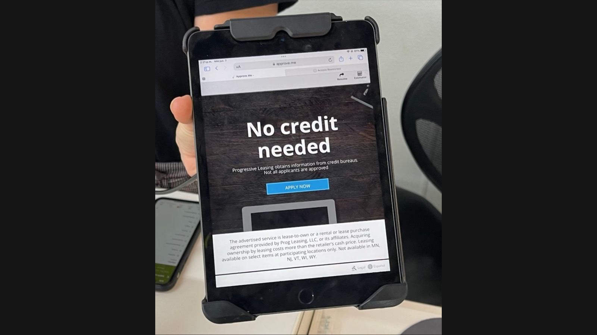
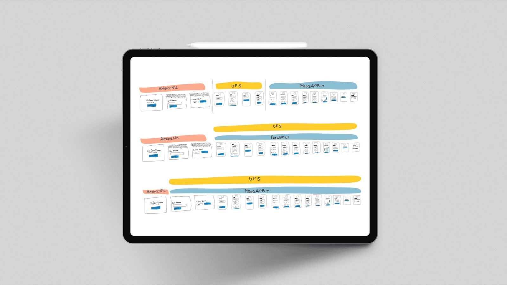
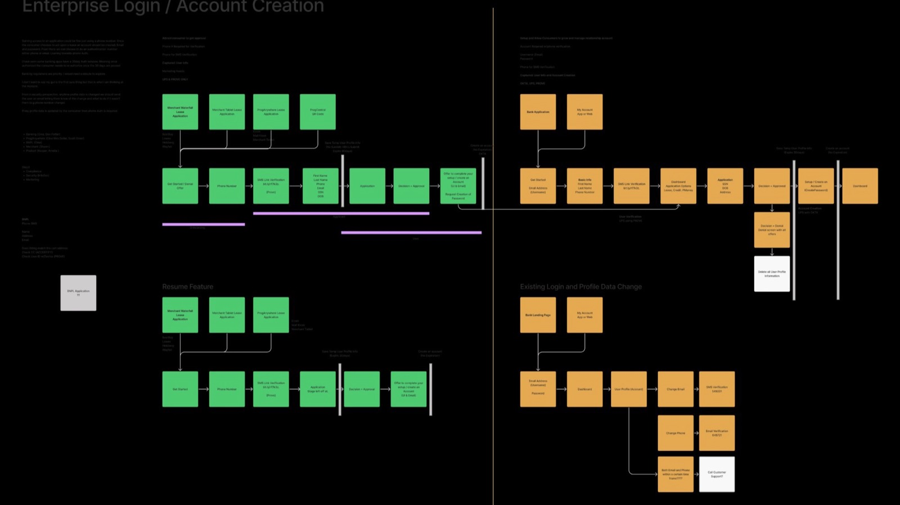
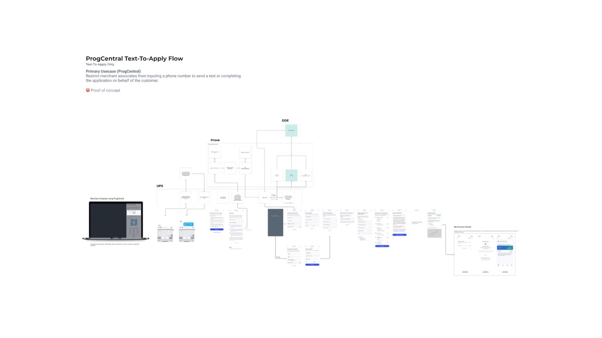
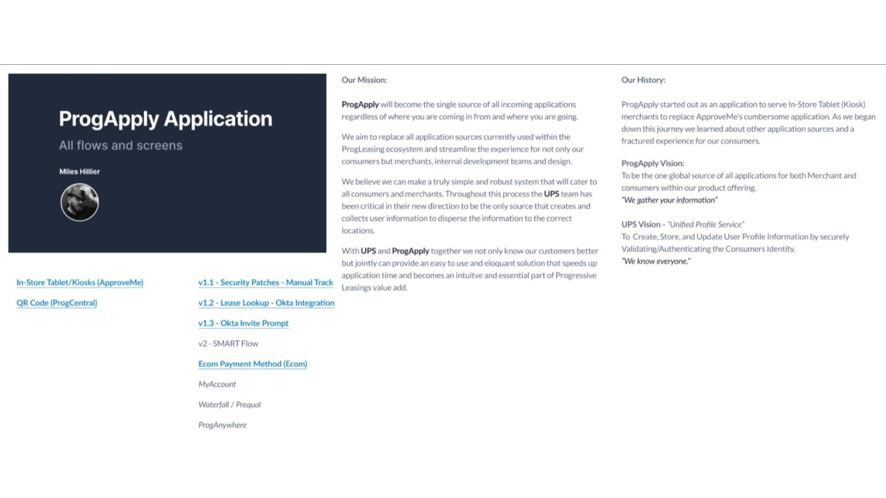
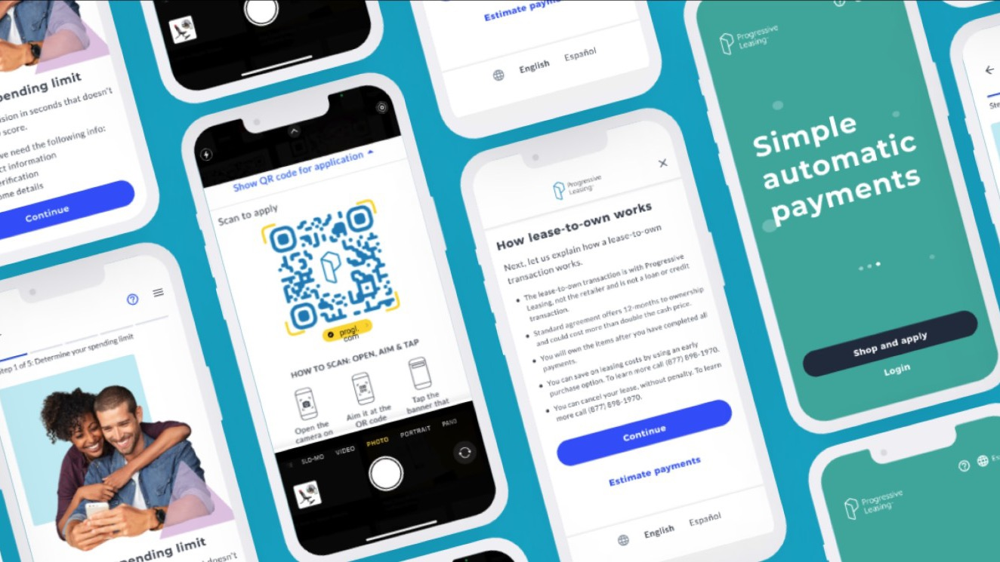

---
# ─────────────────────────────────────────────────────────────────────────────
# Universal Application: everything on the site for this case study lives in
# this file. Save it and the site updates. Anything in [square brackets] shows
# up red while review mode is on, so use brackets for notes that still need
# attention.
#
# Tip: wrap a value in double quotes if it starts with [ or # or contains a colon.
# ─────────────────────────────────────────────────────────────────────────────

id: universal-application    # used in the page address: /watch/universal-application
title: Universal Application
subtitle: The Progressive Leasing Story
tagline: One small request. One application for every product line.
description: >-
  A request to simplify one application flow uncovered a company-wide problem:
  parallel applications, repeated data entry, and teams maintaining redundant
  versions of the same thing. This is the story of turning one flow fix into a
  universal application for Progressive Leasing.

category: product            # product, brand, leadership, or documentary
client: Progressive Leasing
role: Senior Product Designer, Application & Customer Architecture
year: 2022                   # the work ran Sep 2020 – Jan 2023
format: Feature              # Series, Feature, Limited Series, or Short
genre: Fintech
rating: UX-PG
advisories: [compliance, conditional logic, alignment]
badge:                       # optional: New Chapter, Recently Added, Award Winner, Top 10, Coming Soon
match: 96

team:
  - "Miles Hillier (one of three designers; later design for all three teams and interim PM)"
  - 2 other Product Designers
  - 3 Product Managers
  - 1 Director of Product
  - 3 Tech Leads
  - 18 Engineers
disciplines: [Product Design, Systems Thinking, Interim Product Management]
tools: [Figma, Confluence, Jira, UserTesting]
moods: [Systemic, Collaborative]

outcomes:                    # from the old case study on mileshillier.com
  - value: "67%"
    label: Less time to complete an application, in testing
  - value: "52%"
    label: More successful submissions in the pilot
  - value: "$35–45M"
    label: Projected annual GMV increase (internal analysis)

# Images: file names are relative to this folder. A missing file falls back to
# placeholder art (outlined red in review mode).
cover: cover.jpg             # key art: a couple shopping, applying on a phone (AI-generated in Figma), with the P badge
banner: banner.jpg           # the same art without the badge, for page headers
logo: logo.png

accent: "#1E88E5"            # Progressive Leasing blue: artwork glow, subtitle, season labels
titleFont:
  font: "'Anton', sans-serif"
  letterSpacing: 0.01em
  uppercase: true
---

<!--
  How the chapters below are written:

  # Season name                     → starts a season
  ## Chapter title · 2 min          → starts a chapter (read time is optional)
  _One-line summary_                → the chapter's synopsis (italic line under the title)
                 → the chapter image and its caption
  Plain paragraphs                  → body text
  - item  or  1. item               → bulleted or numbered list
  > Quote text                      → pull quote; a final "> — Name, Title" line is the credit
-->

# The Universal Application Story

## The Small Ask · 2 min

_Leadership wanted a shorter application. The real problem was bigger._

I joined Progressive Leasing in September 2020 as a Senior Product Designer for Application and Customer Architecture. This project ran through my whole time on that team, from 2020 into 2023, through constant changes in scope, in the team, and in my own role.

I started as one of three designers. As the project went on, the other two designers left, and I took over design for their teams as well as my own. Product managers turned over often too, so I also stepped in as interim product manager for those three teams, designing and running product at the same time to keep the work moving forward.

The request was simple: streamline ApproveMe, the application customers filled out on tablets in stores, giving them a shorter, more efficient path with less friction and fewer steps.

Once I dug in, it wasn’t one flow. Several application experiences were running in parallel, each with its own structure, fields, and validation rules:

- Customers re-entered the same information, met inconsistent wording, and got lost in confusing steps. Drop-off was high.
- Teams maintained separate versions of the application and duplicated each other’s work.
- Regulatory requirements were layered on differently in each flow.
- With no shared system, each product team solved the same problems on its own, piling up design and technical debt.

What looked like a flow-level UX issue was really a system-level problem, for customers and for the business.

## The Audit · 2 min

_Every application flow, mapped side by side._

I audited every application experience and mapped them side by side to find the redundancies. The finding: 70–80% of the flows overlapped, but each presented the same steps differently.

## One Application · 2 min

_Product, engineering, and compliance agree to build one application, not fix one flow._

I facilitated alignment workshops with product managers, engineers, and compliance. Together we reframed the scope from a single flow fix to a universal application initiative, and I won buy-in by showing what it would mean for customers and for the business.

The plan changed the hardware too. Instead of a store tablet, customers would apply on their own phones, which added fraud prevention and security by tying the application to the customer’s own device. The plan was to replace about 95% of the in-store tablets. The other 5% would stay in mobile phone stores, where some customers came in without a phone because they needed one in the first place.

## Building the Flow · 2 min

_Consolidated inputs, conditional logic, and reusable patterns._

I designed and iterated on prototypes for the universal application:

- Redundant inputs consolidated into one set.
- Conditional logic, so customers only saw the fields that applied to them.
- Reusable input components, error states, and progress indicators.

I partnered with compliance from the start rather than at the end, tested the prototypes with users, and worked with engineering on feasibility and scale.

## The Playbook · 1 min

_Diagrams, specs, and a design system for application inputs._

I documented the universal flow with diagrams and specifications, and delivered a universal design system for application inputs. Then I partnered with product managers on a pilot launch and shared the benefits across teams.

The universal application was still in its pilot when the teams were reorganized and I was assigned to a different team. Some of the work was put on hold, but work to bring the universal application into other areas of the company carried on.

## Approved · 2 min

_Faster for customers, simpler for the teams behind them._

In testing and in the pilot, the universal application showed:

- Completion time: down 67% in testing
- Successful submissions: up 52%, validated in the pilot
- Projected revenue: internal sales and financial analysis projected a $35M–$45M annual increase in GMV (gross merchandise volume)
- Faster launches: with the team reorganized around dedicated focuses, new product lines were integrated in weeks instead of months
- Fewer systems to maintain: departments had been running multiple design systems and their own application systems. Some were retired as the universal application began replacing the applications other teams were building

It was built to give customers a faster, more consistent path to approval, teams a shared framework, and the business a scalable foundation for new products.

What I took away:

- Small asks often uncover larger systemic issues.
- In a regulated industry, bring compliance in early.
- Visual documentation makes invisible problems tangible.
- Scalable design systems last beyond any one project.
