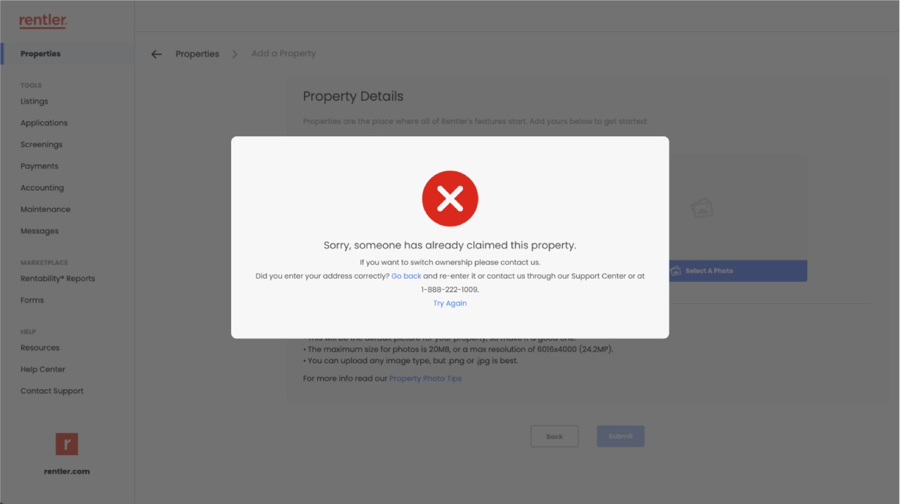
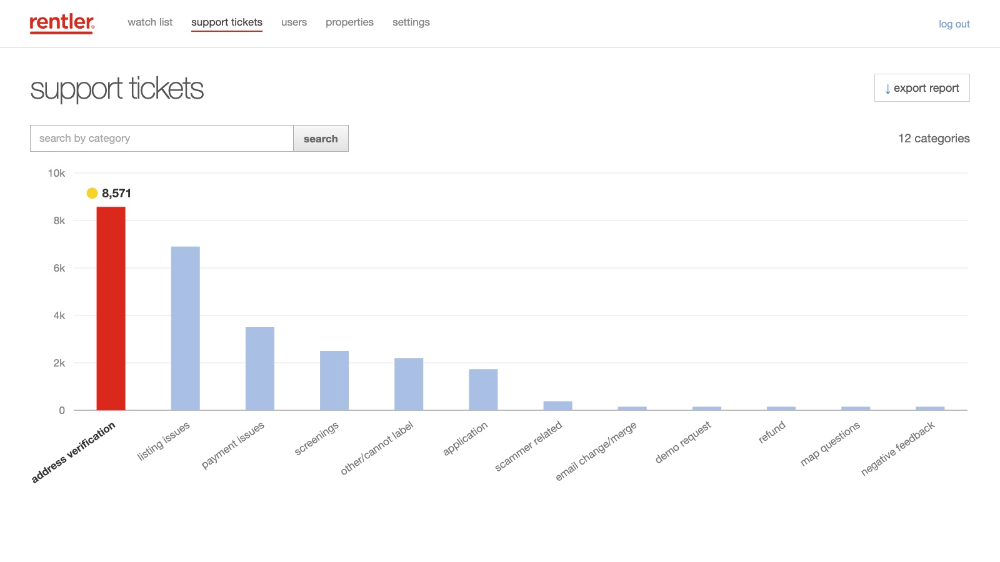
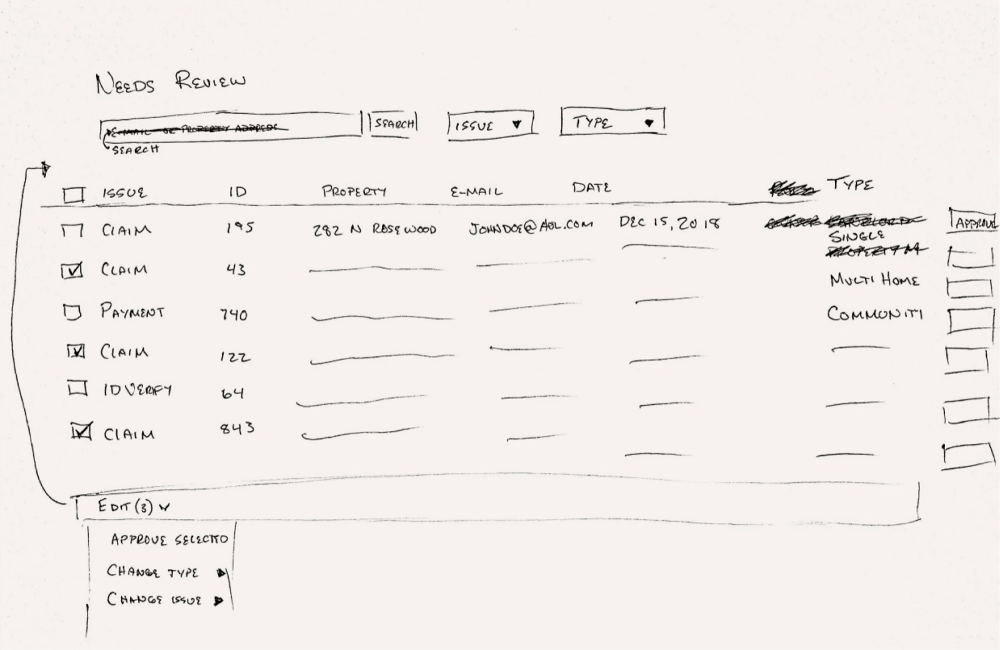
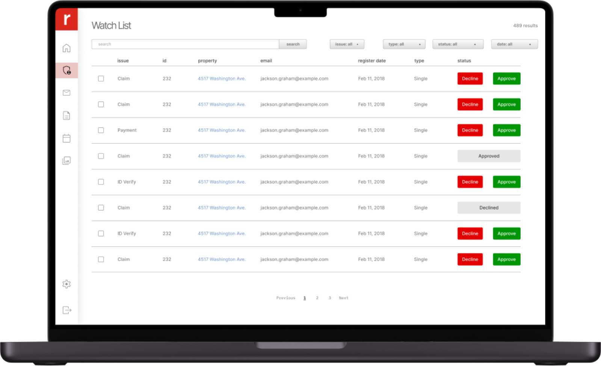
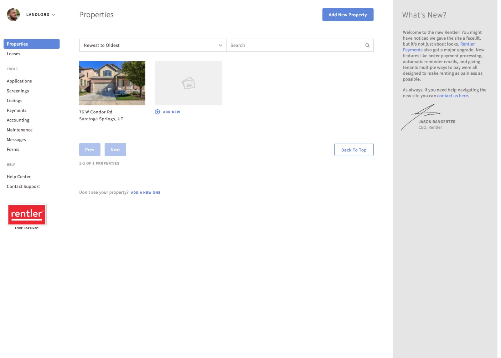

---
# ─────────────────────────────────────────────────────────────────────────────
# Already Claimed: everything on the site for this case study lives in this
# file. Save it and the site updates. Anything in [square brackets] shows up red
# while review mode is on, so use brackets for notes that still need attention.
#
# Tip: wrap a value in double quotes if it starts with [ or # or contains a colon.
# ─────────────────────────────────────────────────────────────────────────────

id: already-claimed          # used in the page address: /watch/already-claimed
title: Already Claimed
subtitle: The Rentler Story
tagline: Landlords blocked in minutes. Let back in without letting fraud through.
description: >-
  Landlords signing up for Rentler were blocked within minutes because someone
  had already claimed their address. This is the story of finding the problem
  behind 8,571 support tickets, and fixing it so legitimate landlords could get
  on the platform while fraud stayed out.

category: product            # product, brand, leadership, or documentary
client: Rentler
role: Product Designer
year: 2018
format: Short                # Series, Feature, Limited Series, or Short
genre: Proptech
rating: UX-PG
advisories: [fraud, support tickets, onboarding]
badge: Recently Added        # optional: New Chapter, Recently Added, Award Winner, Top 10, Coming Soon
match: 93

team:
  - Miles Hillier (sole designer)
  - Director of Engineering
  - "No product manager: I wrote many of my own tickets"
disciplines: [Product Design, User Research]
tools: [Sketch, Figma (early adopter), InVision, Jira]
moods: [Investigative, Pragmatic]

outcomes:
  - value: "82%"
    label: Less drop-off for landlords signing up and listing properties
  - value: "8,571"
    label: Support tickets traced to one problem
  - value: "3"
    label: Support agents freed up for higher-priority work

# Images: file names are relative to this folder. A missing file falls back to
# placeholder art (outlined red in review mode).
cover: cover.jpg             # horror-movie key art: a teal haunted house with someone already in the window
logo: logo.png
imagePosition: top right     # crop the cover and chapter images from the top right instead of the centre

accent: "#DA291C"            # Rentler red (from the logo): artwork glow, subtitle, season labels
titleFont:
  font: "'Archivo Black', sans-serif"
  letterSpacing: -0.01em
  uppercase: true
---

<!--
  How the chapters below are written:

  # Season name                     → starts a season
  ## Chapter title · 2 min          → starts a chapter (read time is optional)
  _One-line summary_                → the chapter's synopsis (italic line under the title)
                 → the chapter image and its caption
  Plain paragraphs                  → body text
  - item  or  1. item               → bulleted or numbered list
  > Quote text                      → pull quote; a final "> — Name, Title" line is the credit
-->

# The Already Claimed Story

## The Brief · 2 min

_Help landlords add properties, list them, and rent to tenants quickly._

The request was simple: let landlords add their properties to Rentler, create listings, and rent to tenants quickly.

Once I dug in, there was a problem nobody had planned for:

- Landlords were blocked within 10 minutes of signing up, because their property had already been claimed by another account.
- 8,571 support tickets had been logged about it, handled by just 3 support agents.
- Rentler was losing landlords, including big property management companies, to competitors.
- Fraudsters were using free listings and duplicate accounts to scam renters.

## Overheard · 2 min

_The clue came from the support desk, not a dashboard._

I sat near the support reps and kept hearing the same call: “claimed properties.” The ticket data confirmed it. 8,571 logged cases were tied to property claim issues.

Then I interviewed internal teams and landlords to understand why accounts were getting blocked and what it cost them.

## Three Doors · 2 min

_Two solutions that couldn’t work, and one that could._

I explored three ways forward:

1. Transfer the property to the new account. Ruled out because of data sensitivity and cost.
2. Let landlords change the profile information on the claim. Ruled out because of system limitations.
3. Let flagged landlords keep going, and hold publishing and payments until support reviewed the claim. Feasible, and it solved the problem.

## The Back Office · 2 min

_An underused admin tool becomes the fix, with a little redesign and some added functionality._

Rentler already had a support admin system, originally built for fraud, that was barely being used. I repurposed it with a few lightweight features:

- Flag duplicate property claims.
- Hold publishing until a claim is reviewed.
- Streamline the review so support could scan, analyze, and resolve flagged cases faster.

Roadmap constraints meant we prioritized function over polish.

At the same time, I redesigned the admin system itself, taking it from a wireframe sketch to a final mockup.

I was the only designer, and there was no product manager. I worked closely with the Director of Engineering to keep us aligned, and wrote many of the tickets myself.

## Unblocked · 2 min

_Legitimate landlords get in. Fraud stays out._

Landlords could now move forward while Rentler stayed protected against fraud. The results:

- Drop-off: 82% less for landlords creating an account and listing their properties
- Support: the 8,571-ticket problem now had a scalable fix, freeing up 3 support agents for higher-priority issues
- Retention: landlords who had been blocked could now get on the platform and stay

What I took away:

- Fraud prevention doesn’t have to come at the cost of user experience.
- Repurposing existing systems can deliver outsized results with minimal engineering.
- Small discoveries, like overhearing support calls, can uncover systemic issues.
