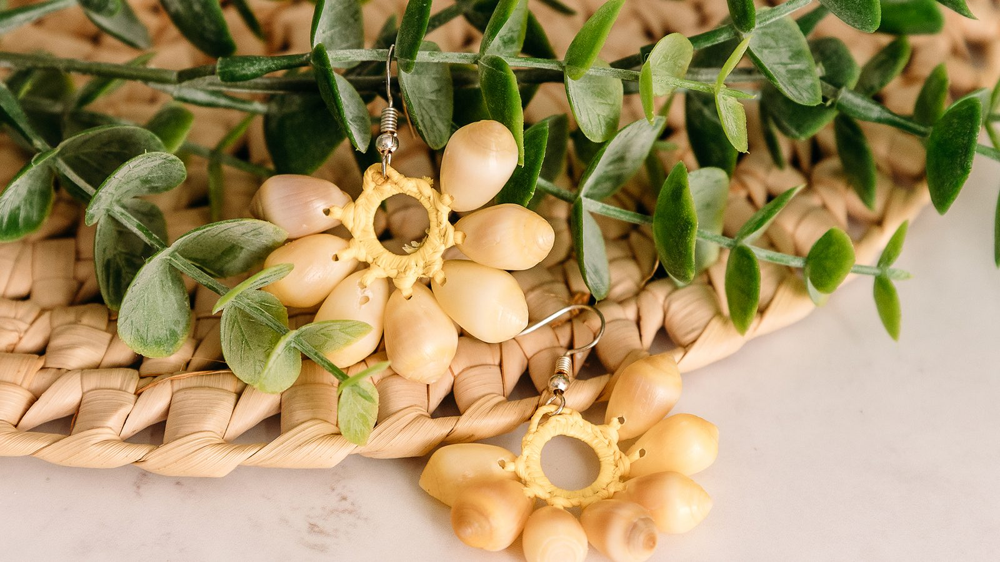
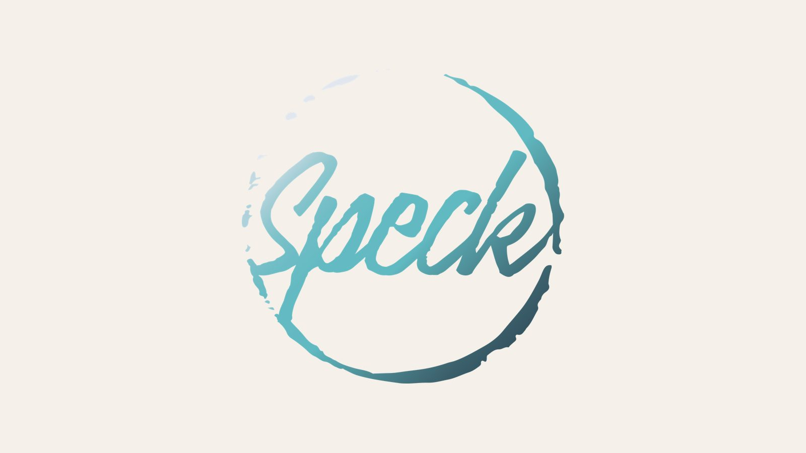
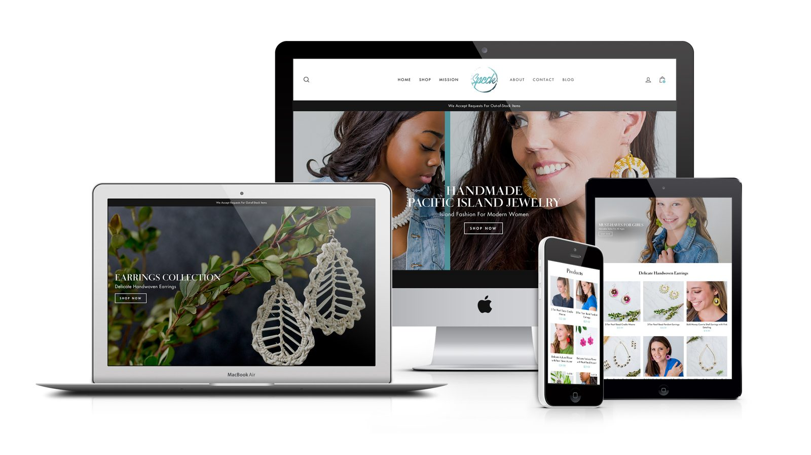
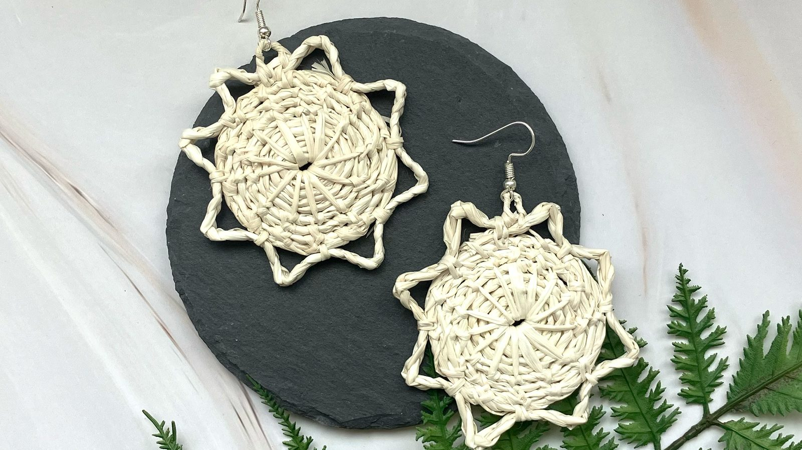
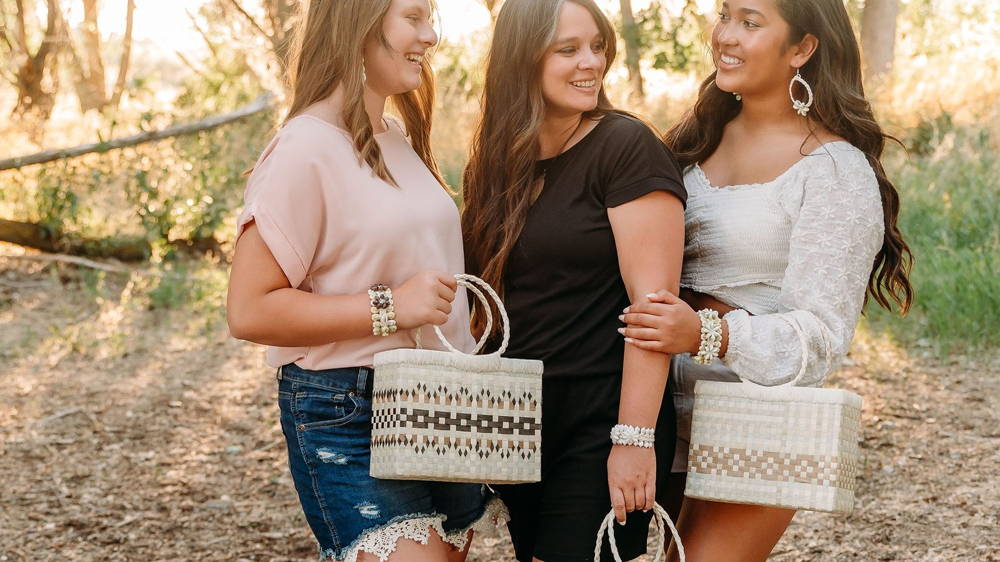

---
# ─────────────────────────────────────────────────────────────────────────────
# Speck Fashion: everything on the site for this case study lives in this file.
# Save it and the site updates. Anything in [square brackets] shows up red
# while review mode is on, so use brackets for notes that still need attention.
#
# Tip: wrap a value in double quotes if it starts with [ or # or contains a colon.
# ─────────────────────────────────────────────────────────────────────────────

id: speck-fashion            # used in the page address: /watch/speck-fashion
title: Speck Fashion
subtitle: A Brand Story from the Marshall Islands
tagline: A speck in the Pacific, and a craft worth keeping.
description: >-
  Handmade crafts from the Marshall Islands, woven from leaves and shells, are
  a dying art as younger generations move to the United States. Speck Fashion
  was started in 2012 to keep that craft going, selling work made by women in
  the Marshall Islands, with a brand built from the islands themselves.

category: brand              # product, brand, leadership, or documentary
client: Speck Fashion
role: Co-founder, Brand Strategy & Photography
year: 2012                   # founded
format: Series               # Series, Feature, Limited Series, or Short
genre: Fashion & Retail
rating: BR-G
advisories: [atolls, shells, culture]
badge:                       # optional: New Chapter, Recently Added, Award Winner, Top 10, Coming Soon
match: 94

team:
  - "Miles Hillier (co-founder: logo strategy, creative direction, photography, social & email)"
  - "Bethanie Hillier (co-founder: logo design, Shopify store, photography, social & email)"
disciplines: [Brand Strategy, Creative Direction, Photography, Social & Email]
tools: [Shopify, Etsy, ChatGPT, Lightroom, Photoshop]
moods: [Purposeful, Handmade]

outcomes:                    # from the Etsy shop page, October 2026
  - value: "920"
    label: Sales on Etsy
  - value: "4.9★"
    label: Average rating, from 257 reviews
  - value: "6 yrs"
    label: On Etsy

# Images: file names are relative to this folder. A missing file falls back to
# placeholder art (outlined red in review mode).
cover: cover.jpg             # full photo with the Speck logo: cards and thumbnails
banner: banner.jpg           # page headers
logo: logo.png
logoInColor: true            # keep the logo's sea teal instead of turning it white

accent: "#60B8C0"            # Speck sea teal (from the logo): artwork glow, subtitle, season labels
titleFont:
  font: "'Cormorant Garamond', serif"
  weight: 600
  italic: true
  letterSpacing: 0.01em
---

# The Speck Fashion Story

## A Speck in the Pacific · 2 min

_Leaves, shells, and a craft that was starting to disappear._

The idea for Speck came from my time doing service in the Marshall Islands, where I met the people and learned their culture. Many in the newer generations were moving to the United States and losing touch with that culture along the way. The crafts the women make from leaves, shells, and other materials from the islands were becoming a dying art, and I wanted to help keep them going.

Bethanie and I started Speck Fashion in 2012. Every product is made by women in the Marshall Islands.

## The Name and the Mark · 2 min

_An atoll, the sea, and a grain of sand that leaves a lasting presence._

The Marshall Islands are a speck in the middle of the Pacific Ocean. Grains of sand are specks too, and they leave a lasting presence. That gave the brand its name.

The logo is shaped like an atoll, much like Majuro, and its colours represent the sea. We co-designed it: I shaped the strategy behind it, and Bethanie designed the mark.

## From Shopify to Etsy · 2 min

_A custom storefront first, then a leaner home where the shoppers already are._

Speck's first online store was built on Shopify. Bethanie built it, and I gave it its creative direction. It was live for about two years before we moved the shop to Etsy. Today, speckfashion.com points straight to our Etsy shop. For a small business like ours, Etsy is the cheaper option and does what we need.

As of October 2026, the Etsy shop has made 920 sales over six years, with a 4.9-star average from 257 reviews.

## Behind the Lens · 2 min

_Parks, a studio of our own, and every camera we had._

Bethanie and I shot most of the product photography ourselves, in local parks and in our own in-house studio. We used whatever fit the shot: a DSLR, a mirrorless camera, a phone, and a lighting setup. We hired out some of the model shoots, and used AI for some of the imagery.

The look we were going for was elegant and friendly: island heritage and culture, woven into everyday life.

## The Vision · 2 min

_Named artists, new islands, and a share for the next generation._

This is where we want Speck to go next. None of it has launched yet.

- **Artists, not just products.** We want to highlight the individual women who make these crafts, so each one becomes an artist in her own right, with her own pieces to sell.
- **More of the Pacific.** We plan to expand beyond the Marshall Islands to other islands across the Pacific.
- **A share for the kids.** For every island we bring under the Speck Fashion brand, we want to set aside a portion of the proceeds to support the children there and their education.
- **Back to our own store.** As we grow, we plan to reopen the Shopify site and sell directly again.

That way, this passion project supports not only the women of the islands but their children too. It also raises awareness that these islands and their cultures exist, and lets the people who buy the jewelry feel like part of that island culture.
