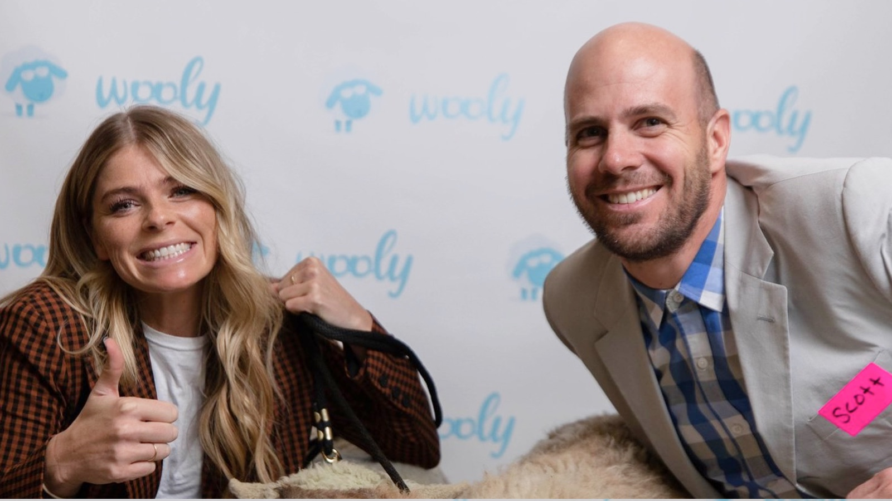
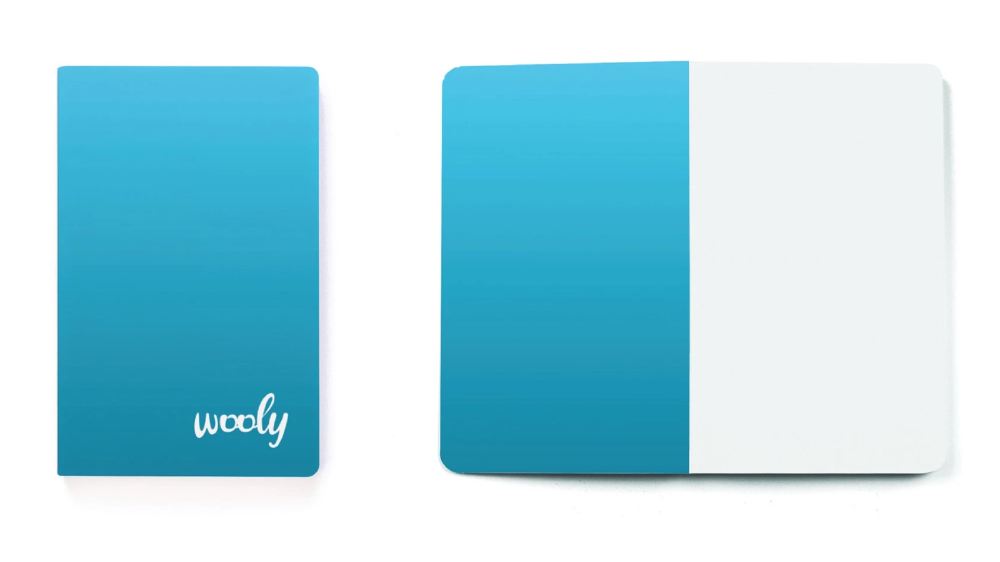
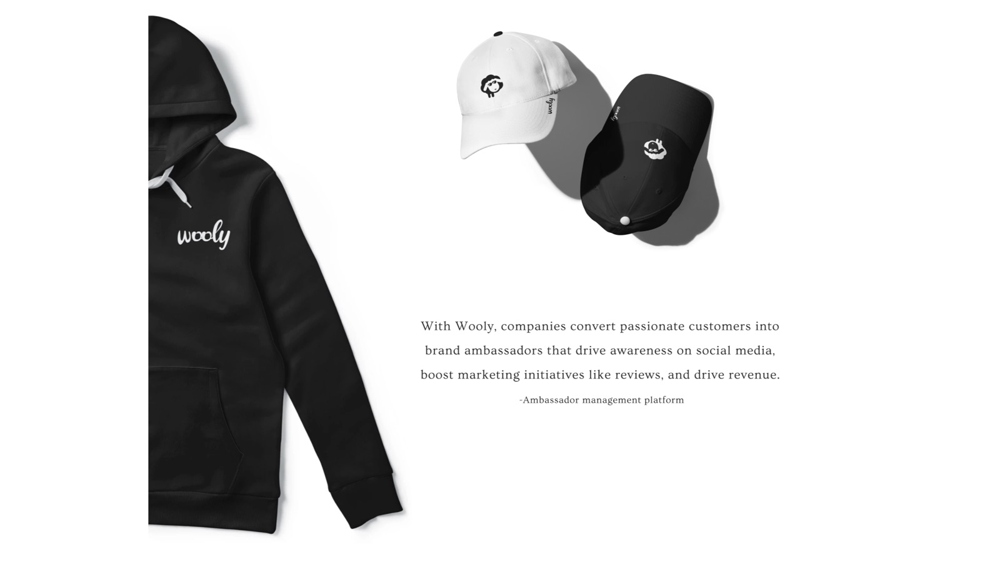
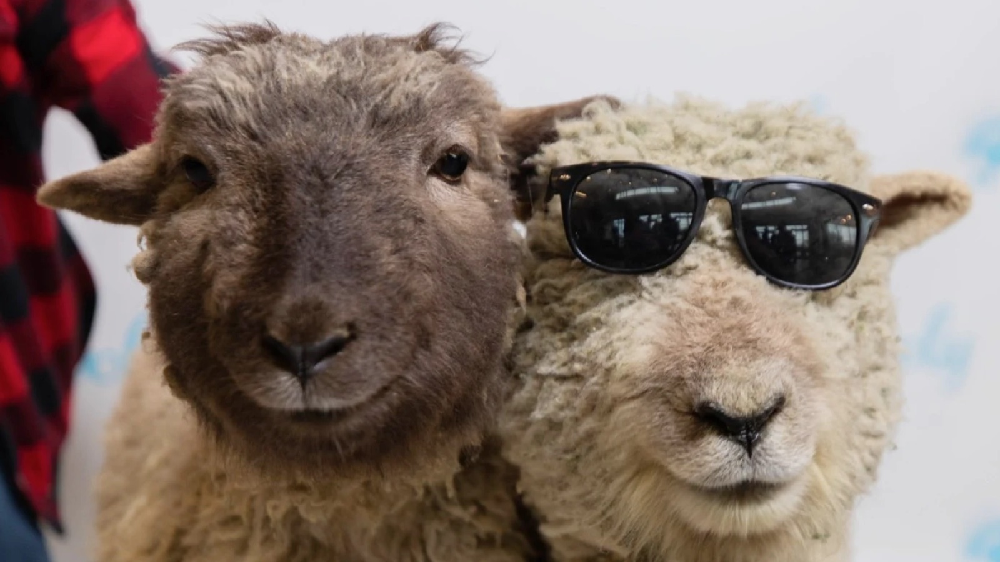

---
# ─────────────────────────────────────────────────────────────────────────────
# Wooly: everything on the site for this case study lives in this file. Save it
# and the site updates. Anything in [square brackets] shows up red while review
# mode is on, so use brackets for notes that still need attention.
#
# Tip: wrap a value in double quotes if it starts with [ or # or contains a colon.
# ─────────────────────────────────────────────────────────────────────────────

id: wooly                    # used in the page address: /watch/wooly
title: Wooly
subtitle: The Wooly Brand Story
tagline: A simpler brand, a room full of clients, and a few surprise sheep.
description: >-
  Wooly, an ambassador management platform, brought the brands it worked with
  together for a networking event: a chance to meet one another, hear what
  Wooly had done for brands like theirs, and talk about where it should go
  next. This is the story of simplifying an existing brand for swag and event
  materials, and the day it all came together.

category: brand              # product, brand, leadership, or documentary
client: Wooly
role: Product Designer & Brand Manager
year: 2019                   # the event; Miles was at Wooly Nov 2018 – Sep 2020
format: Limited Series       # Series, Feature, Limited Series, or Short
genre: Events & Marketing
rating: BR-G
advisories: [sheep, swag, networking]
badge:                       # optional: New Chapter, Recently Added, Award Winner, Top 10, Coming Soon
match: 94

team:
  - "Miles Hillier (sole designer, Product Designer & Brand Manager: rolled the existing logo out across social, web, and product; designed the swag and event materials)"
disciplines: [Brand Identity, Print Design, Event Design, Swag]
tools: [Illustrator]
moods: [Playful, Friendly]

# Images: file names are relative to this folder. A missing file falls back to
# placeholder art (outlined red in review mode).
cover: cover.jpg             # sheep stickers and the wooly wordmark
logo: logo.svg               # the wooly logotype (white)

accent: "#48C6EC"            # Wooly brand blue (Pantone 297 C): artwork glow, subtitle, season labels
titleFont:
  font: "'Righteous', sans-serif"
  letterSpacing: 0.01em
---

# The Wooly Story

## Brands in One Room · 2 min

_A networking event for the brands Wooly worked with._

In 2019, Wooly invited the brands it worked with to a networking event at the Kiln in Lehi, Utah. They came to meet one another, to hear talks about what Wooly could do and had already done for brands like theirs, and to talk with us about how Wooly should evolve.

## One Logo, Everywhere · 2 min

_Taking an existing logo into every place people met Wooly._

The Wooly logo was already designed when I joined, and the sheep was already part of the brand. My job was to bring it into every place people met Wooly: our social platforms, our website, and the product itself. For the event, I designed the swag and the event materials.

## Keeping It Simple · 2 min

_A multi-layered logo, simplified for vinyl, fabric, and print._

I wanted to keep things simple and clean. The original logo was multi-layered and multi-coloured, which doesn't hold up on a vinyl sticker or a t-shirt, so I simplified it for vinyl stickers, t-shirts, and other branding materials.

From there I made the swag: shirts, beanies, hats, notebooks, the event backdrops, and the other typical swag items.

## Sheep in the Building · 2 min

_A surprise from the CEO, and the conversations that came after._

Bringing real sheep to the event was our CEO's idea, and it was a surprise to the rest of the team. It's what made the event memorable.

I don't remember every conversation, but two themes stuck with me. Brands wanted easier integrations, because the rules on social platforms seemed to change day to day. And they told us they loved how easily they could make sure transactions between them and their ambassadors happened quickly and smoothly, without friction.
